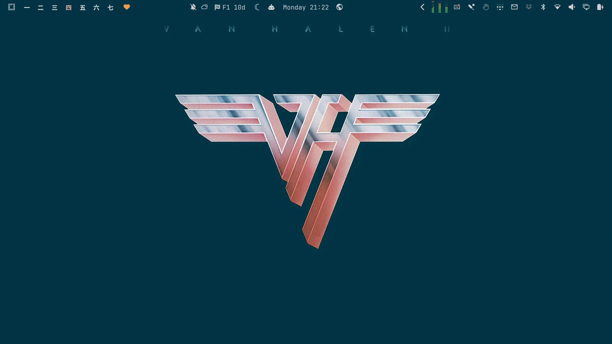
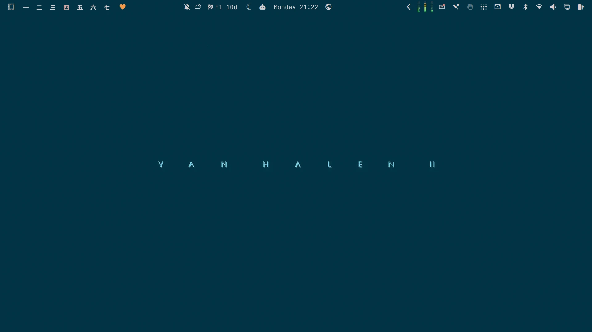

# Van Halen II

An [Omarchy](https://omarchy.org/) theme from the cover of *Van Halen II* (Warner Bros., 1979). The desktop takes the sleeve's deep teal, with windows a shade darker. Text is the silver of the chrome VH logo, and the accent is its pink.


## Install

```bash
omarchy theme install https://github.com/keithrowell/omarchy-van-halen-ii-theme
```

The theme applies as soon as it installs.

## Backgrounds

<table>
  <tr>
    <td width="50%"><br><code>1-van-halen-ii.jpg</code>: the full sleeve, with the title above the winged logo</td>
    <td width="50%"><br><code>2-wings.jpg</code>: the winged logo alone</td>
  </tr>
  <tr>
    <td width="50%"><br><code>3-title.jpg</code>: the title alone</td>
    <td width="50%"></td>
  </tr>
</table>

Switch between them with `omarchy theme bg next`.

## btop


## Licence

The theme files are MIT licensed, see [LICENSE](LICENSE). The wallpapers and screenshots are built from the album artwork, which belongs to its rights holders. This is an unofficial fan theme.
