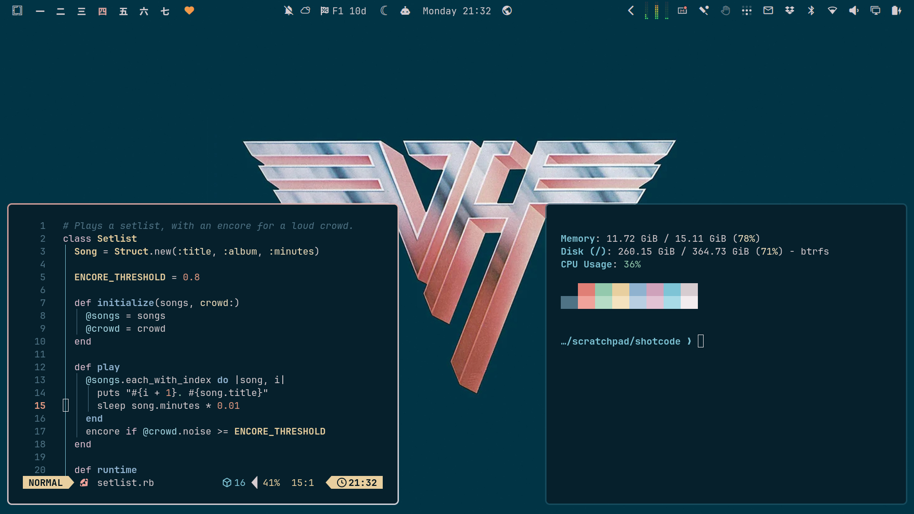
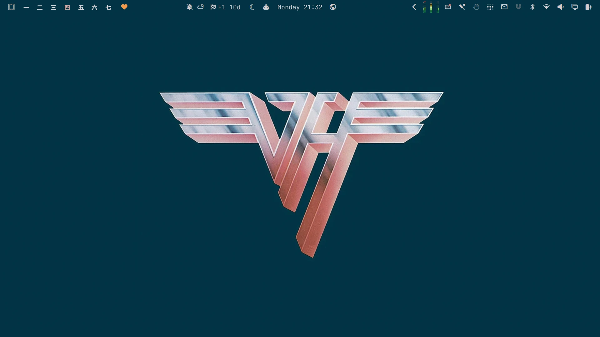
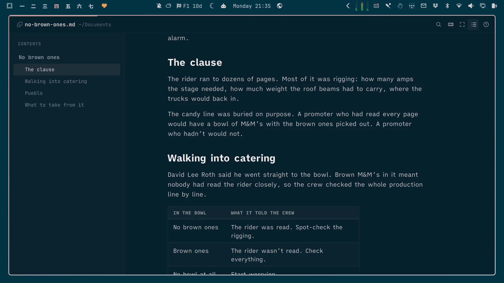
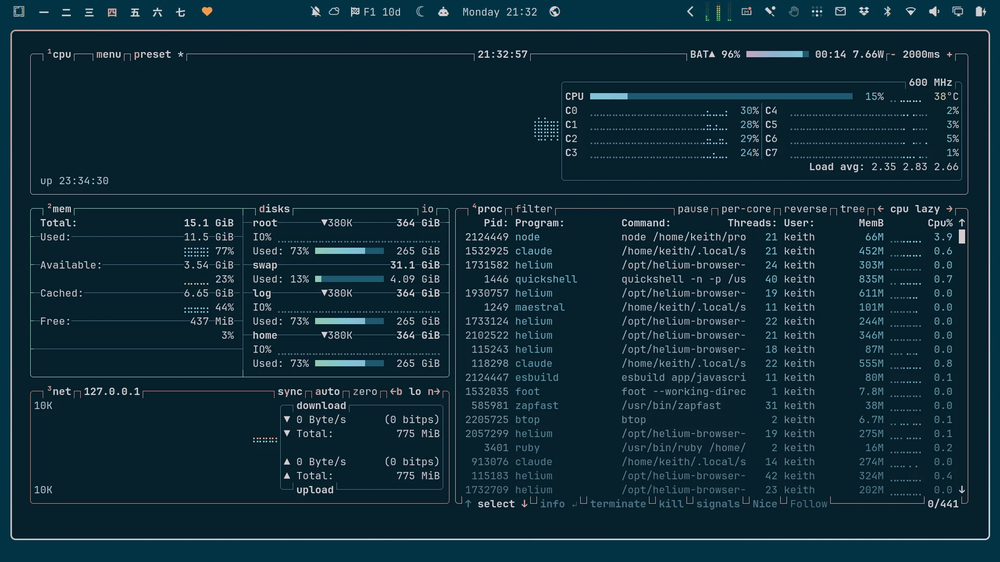

# Van Halen II

An [Omarchy](https://omarchy.org/) theme from the cover of *Van Halen II* (Warner Bros., 1979). The desktop takes the sleeve's deep teal, with windows a shade darker. Text is the silver of the chrome VH logo, and the accent is its pink.



## Install

```bash
omarchy theme install https://github.com/keithrowell/omarchy-van-halen-ii-theme
```

## Background



## OmarkyReader

[OmarkyReader](https://github.com/keithrowell/omarky) reads Markdown in the theme's colours.



## btop



## Licence

The theme files are MIT licensed, see [LICENSE](LICENSE). The wallpaper and screenshots are built from the album artwork, which belongs to its rights holders. This is an unofficial fan theme.
